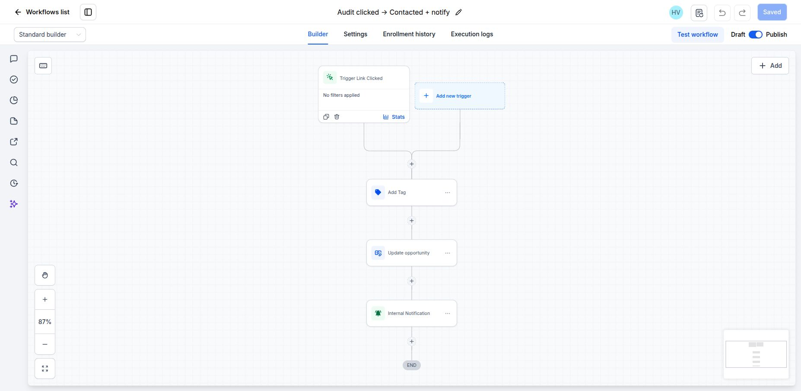
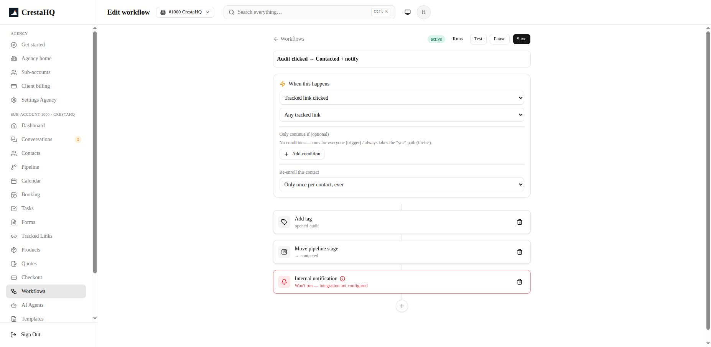
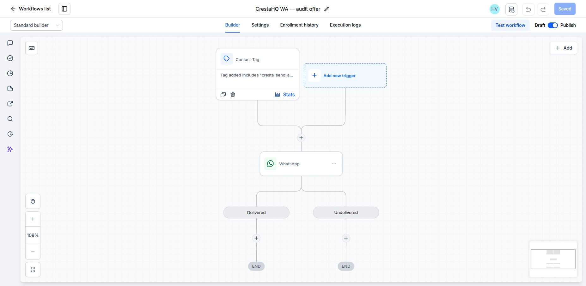
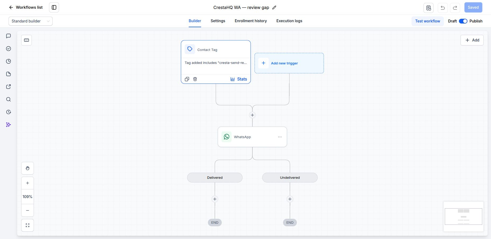
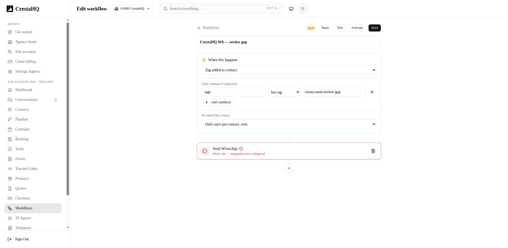

# SP0-C workflow screenshots — 2026-09-07

Captured from the authenticated live builders at approximately 15:33–15:38 SAST.
These are configuration evidence, not proof of sending or delivery. No workflow
was saved, activated, tested, or paused during capture.

GHL source: CrestaHQ / Somerset West (`jEr9SOZnEyVsi8oK2Vnj`).
CrestaHQ target: #1000 (`54vPI0BS1zDMcxMyMAyA`).

| Workflow | GoHighLevel | CrestaHQ |
| --- | --- | --- |
| Audit clicked → Contacted + notify |  |  |
| WhatsApp audit offer |  |  |
| WhatsApp no website |  |  |
| WhatsApp review gap |  |  |

## Observed parity and gaps

- The audit workflow has the corresponding link-click trigger, add-tag,
  pipeline-stage, and notification steps. GHL is published; CrestaHQ is active.
- The three campaign trigger tags correspond. All three GHL workflows are
  published, while all three CrestaHQ campaigns remain **draft**.
- GHL has Delivered and Undelivered branches, both terminating. CrestaHQ has a
  linear send step: the delivery-branching gap accepted in the SP0-C plan.
- CrestaHQ's WhatsApp nodes display “Won't run — integration not configured”.
  Code inspection identifies a builder limitation: `workflows/[workflowId]/page.tsx`
  computes one `whatsappReady` flag requiring template support and an approved
  template, even for `send_whatsapp` on the bridge. This display warning is not
  live runtime health evidence. The engine uses its own provider readiness check.
- The audit notification node also displays an integration warning. Notification
  delivery was not tested during this capture; its readiness remains unresolved.
- The screenshots do not expose every node's message body or prove equivalence of
  every setting. The prior handoff records the workflow reconstruction and live
  canary evidence. A campaign cutover remains a separate human decision.

## Source records

| Workflow | GHL workflow ID | CrestaHQ workflow ID |
| --- | --- | --- |
| Audit clicked | `e0ed7429-fe13-488e-896c-ff9bfaafff02` | `eO3JGanGhu7Gf9DMiw32` |
| Audit offer | `3d8479ce-c056-4cfb-84fb-acc2b8bf4957` | `iIW4Uedwtw6aURzlm4KE` |
| No website | `b2ae75b8-86fc-4e60-8d3d-ca234ff7a8a5` | `G8cJHxIXf6VOLCLpNojv` |
| Review gap | `06d91775-d54c-427c-b6af-8dfbbc40aff3` | `1VUjeEwnbwSWJsRQhWHt` |
