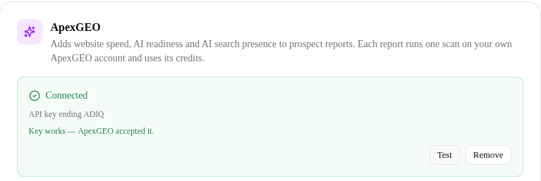
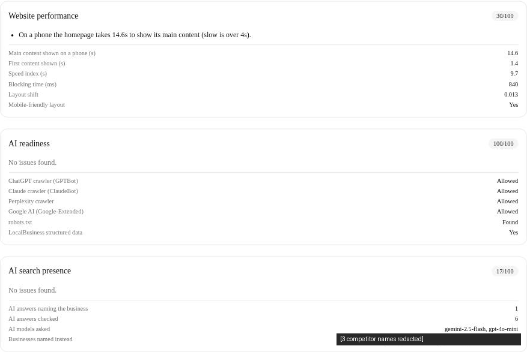
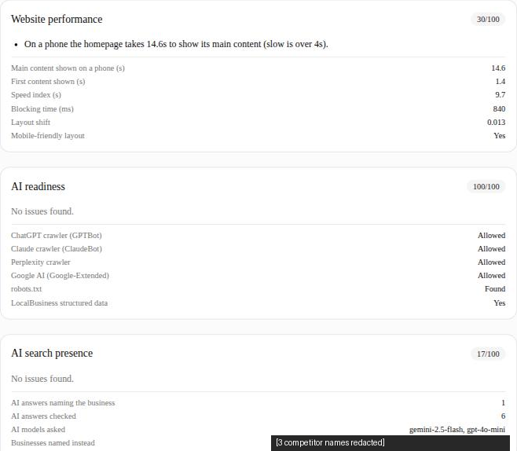
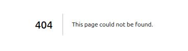

# Prospecting PR 3 — evidence

PR #302, merged 7f7b4882, deployed 2026-09-27 13:59 SAST (crestahq@4301 behind the proxy). The prospect's name, website and share token appear in none of these images; the three competitor names in the AI-presence card are redacted too.

## Prod proof on #1000 (2026-09-27, Sunday)

| Step | Result |
|---|---|
| Key | Minted in ApexGEO's Brightsphere dogfood org (read + write scopes). Stored server-side on #1000 in `private/apexgeoConnection`, exactly as the connect route does (a browser session may not type a key into a production field). |
| Settings card |  — "Connected · ending ADlQ", **Test** → "Key works — ApexGEO accepted it." |
| Report | Generated from the contact's Prospect reports card. Ready at 12:03:51Z with 5/7/8 `pending`. Poll 1 (12:04:41) found the scan running; poll 2 (12:05:31) filled all three. Cost: `http 6, placesDetails 1, apexgeoScans 1, apexgeoCredits 7`. Headline recomputed to "On a phone the homepage takes 14.6s to show its main content". |
| Member view |  — website performance 30, AI readiness 100, AI presence 17 (1 of 6 answers named the business). |
| Public share |  — HTTP 200 logged out (curl), the same three sections, no mention of the vendor. |
| Revoke |  |
| Cleanup | The report and its share doc were deleted. `usage/2026-09.prospectReports` (absent before), the contact's `prospecting.lastReportId` (absent before) and its `city` (null before; temporarily set to the city in its own stored address) are all back to their prior state. The ApexGEO key stays connected. |

ApexGEO spend: 1 scan, 7 credits.

## CI and review

- Unit/lint/typecheck/build and E2E green on the PR head; main push CI green; the prod smoke (which includes the new spec) was green after the deploy.
- The E2E spec was proven red once: #303 (D6 filter removed, CI narrowed) failed at the absent-section assertion.
- Mutation table: [mutations.md](mutations.md) — 72 mutants, 72 killed.
- Blind reviews: three rounds, both reviewers APPROVED/SHIP on the final commit.
