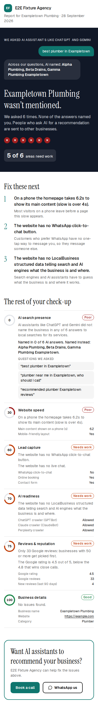
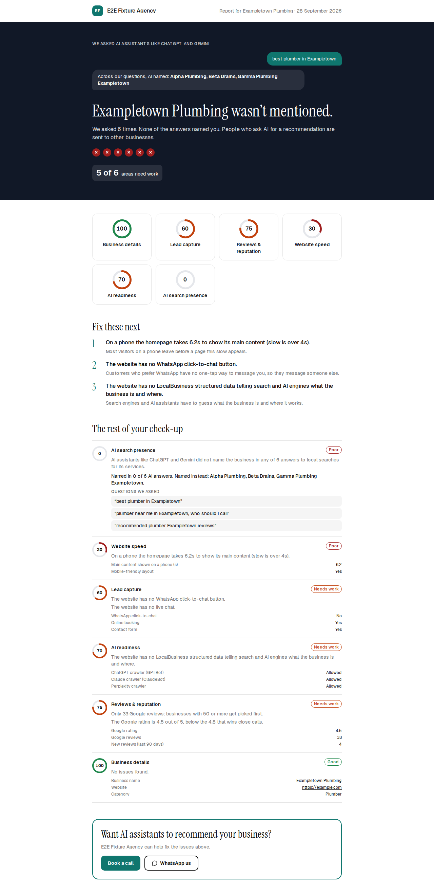
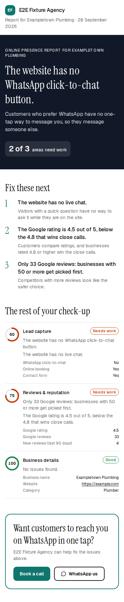
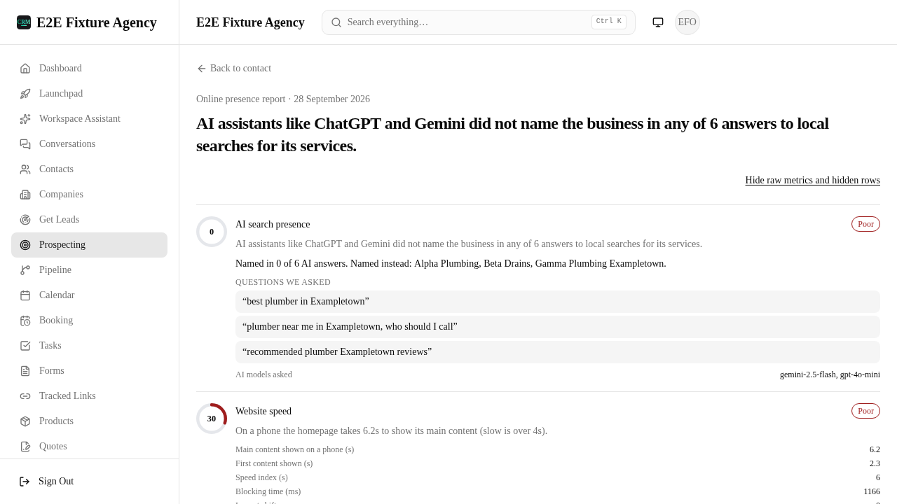

# Prospect report R3 — evidence

Direction C "Story" with Hein's two changes (hero adapts to the headline; desktop ring grid).
Screenshots come from `e2e/specs/prospect-report-story.spec.ts` against the real standalone
server, on fixture data only (made-up business, competitors and WhatsApp number).

| Shot | What |
|---|---|
|  | 390×844, AI-presence headline: chat hook, 0-of-6 marks, "Fix these next" (findings 2–4), check-up rows, CTA in the brand colour |
|  | 1280×900, same report: ring grid under the hero |
|  | 390×844, another headline: the same dark hero leads with it and its impact |
|  | 390×844 on a dark-scheme device: the page stays light, traffic-light colours unchanged |
|  | Member view with the toggle on: raw metrics, the counts and the models asked (member-only rows) |

Mutation table: [mutations.md](mutations.md).
