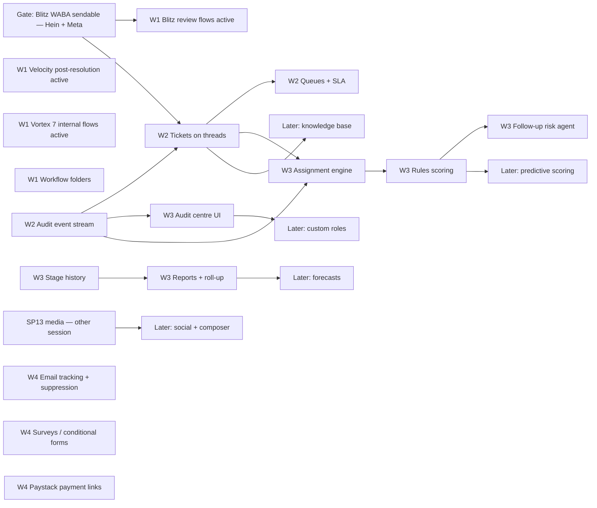

# CRM gap programme

*Planning, not approval to build.* Source research: `.claude/handoffs/2026-09-15-1303-crm-competitive-gap-planning.md`.
Supersedes the unstarted parts of [PARITY_PROGRAM.md](../PARITY_PROGRAM.md) (SP4, SP6–SP12, SP14);
the finished SP ledgers in [docs/parity/](../parity/) stay the evidence record.

## Decisions (grilled 2026-09-15)

1. **GHL is stopped.** SP14 "cutover" is no longer a finale — its leftovers are live-tenant gaps and rank first.
2. **SP13 (agency ops) is in flight in another session.** This plan consumes its outputs (media storage,
   snapshot sharing) and does not re-plan it.
3. **Ranking key:** what is hurting Blitz / Velocity / Vortex operators today, then resale value.
4. **Fixed, typed objects — no generic metadata layer.** Tickets layer on Conversations threads,
   forecasts on Deals, scoring and assignment are services. Positioning: operating CRM for
   agencies and service businesses, not a configurable Zoho/Salesforce platform.
5. **Nothing is rejected.** Items not built now are *Later*, each with a named trigger. A Later item
   moves only when its trigger fires — not because a session finds it attractive.
6. **AI autonomy has two tiers.** Internal writes (tasks, tags, priority, scores, drafts, evidence notes)
   may run on a schedule behind a per-tenant gate and are always audit-logged. Anything outbound
   or customer-visible stays human-confirmed.

## Live baseline (read from production, 2026-09-15)

Code baseline `origin/main` c13afcd; production deploy dir at b4e6850. Counts are a read-only
Firestore query, not a claim about the code.

| Tenant | Active workflows | Runs ever | Conversations | Messaging channel in LeadStack |
|---|---|---|---|---|
| Velocity Fibre | 2 (Installation Experience, QContact Installation Request) | 387 | 4,007 | WhatsApp Cloud (new WABA), SMTP mailbox, bridge |
| Blitz Fibre | **0** — 3 rebuilt review flows are drafts, 41 imports are drafts | **0** | 5,052 | **none** — WABA locked to LeadConnector credit line (#200) |
| Vortex Media | **0** — 42 imports are drafts | **0** | 58 | **none** — WABA has no number |
| ONT Appliances | 0 (6 imported drafts) | 0 | 0 | none |
| CrestaHQ #1000 | 2 | 28 | 263 | SMTP, mailbox, Google, Paystack |

**What this means:** with GHL off, Blitz has no automated review asks and no outbound WhatsApp at
all, and Vortex has no automation. Only Velocity is actually running on LeadStack.

## Current-state matrix

State key — **C** in code on main · **T** tested in CI/fixture · **D** deployed · **L** proven live on a real
tenant/provider · **—** absent. Decision — **Now** (waves 1–3) · **Later** (trigger named) .

### Operations the three businesses need now

| Capability | Source | State | Value / tenant | Dependencies & gates | Decision |
|---|---|---|---|---|---|
| Blitz WhatsApp on a sendable WABA | SP14 | — | Blitz: 5,052 threads with no outbound | **Hein + Meta**: new WABA/number (Velocity path, 2026-09-13) | Now · W1 |
| Blitz review workflows active (PE, PTA, post-resolution) | SP6/SP14 | C T, draft | Blitz review volume stopped with GHL | WhatsApp above; templates re-approved on the new WABA | Now · W1 |
| Velocity post-resolution review ask | SP6 | C T, draft | Velocity | nothing new; activation is a human gate | Now · W1 |
| Vortex 7 commercial workflows reviewed + activated | SP6 | imported drafts with real graphs (3–18 nodes), built from internal steps (create_task, notify, move_stage, add_tag) — `notify` sends email and Vortex has no SMTP connection — sender must be settled first | Vortex sales follow-up | stage-changed triggers must match Vortex's actual pipeline stages; 3 WA nudges need a Vortex number (none) — left draft | Now · W1 |
| Blitz "Service Issues" (86 GHL opportunities) | GHL / Zoho Desk | — | Blitz support load | Tickets on Conversations | Now · W2 |
| Workflow run log, test enrol | SP6 | C T D | — | — | Done (keep) |
| Workflow folders, goal events, per-step conversion | SP6 / Close | — | operators with 40+ drafts per tenant | none | Now · W1 (folders), W3 (rest) |
| Per-contact send windows / blackout dates | Close | partial (WA refusals, watchdog quiet hours) | outbound hygiene | none | Now · W3 |
| Workflow triggers beyond 18 / nodes beyond 14 | SP6 / GHL | C T D (18/14) | depends on rebuild needs | pull only what a W1 rebuild needs | Now · W1 (as needed) |

### Service desk

| Capability | Source | State | Decision |
|---|---|---|---|
| Ticket on a conversation thread (status, priority, owner, category) | Zoho Desk, HubSpot | — | Now · W2 |
| Support queues/views, SLA timers, escalation task | HubSpot, Zoho | — | Now · W2 |
| Merge / split / link tickets | Zoho, HubSpot | — | Later — trigger: >5% duplicate tickets on Blitz after 30 days |
| Macros | Zoho | snippets exist (C T D) | Now · W2 (snippets + status change) |
| Knowledge base tied to tickets and AI answers | Espo, Zoho | AI website KB only | Later — trigger: ticket categories stable for 60 days |
| Customer portal | Espo, Zoho | billing portal only | Later — trigger: a tenant asks for customer self-service |

### Sales intelligence and reporting

| Capability | Source | State | Decision |
|---|---|---|---|
| Stage history + time-in-stage, velocity, conversion | Attio, HubSpot | `stageChangedAt` only (no history) | Now · W3 |
| Agency roll-up + configurable report widgets | SP11, Zoho | per-SA KPIs, attribution, payments report | Now · W3 |
| Assignment engine (criteria, weighted round robin, capacity) | Zoho, Odoo | round robin in booking only | Now · W3 |
| Rules-based lead / engagement scoring | HubSpot, Zoho | — | Now · W3 |
| Unattended-lead / follow-up risk | Close, Comp AI | Labs watchdog (inbox only) | Now · W3 (extend watchdog) |
| Forecast categories, targets, rollups | Zoho, HubSpot, Salesforce | — | Later — trigger: a tenant with ≥3 reps and a monthly target |
| Predictive (ML) scoring | Zoho Zia, Odoo | — | Later — trigger: 6 months of rules-scoring outcomes on a real tenant |
| Territory hierarchies for deals | Zoho, Salesforce | flat territories (C D) | Later — trigger: a tenant with nested regions |

### Communications and marketing

| Capability | Source | State | Decision |
|---|---|---|---|
| Email delivery / open / click / bounce + suppression | SuiteCRM, SP8 | unsubscribe only | Now · W4 |
| Visual email composer, A/B | SP8, GHL | — | Later — trigger: a tenant runs ≥2 broadcasts a month |
| Multi-network social (LinkedIn, GBP posts) + media library | SP8 | Meta only; media = SP13 | Later — trigger: SP13 media storage lands + GBP case approved |
| Multiple mailboxes per user, protected recipients | Attio, HubSpot | one mailbox per SA | Later — trigger: a tenant with shared + personal inboxes |
| Microsoft 365 mail + calendar | HubSpot, Zoho | ICS feed only | Later — trigger: a tenant on Microsoft 365 asks |
| Multiple conflict calendars | GHL SP3 | Google primary only | Later — trigger: a booking conflict reported from a second calendar |

### Sites, commerce and agency (remaining GHL)

| Capability | Source | State | Decision |
|---|---|---|---|
| Surveys / multi-step conditional forms | SP4 | 6 field types, no conditions | Now · W4 |
| Funnels / page builder | SP4 | funnels + checkout routes exist (C); gitpage builder not activated | Later — trigger: a paying tenant needs a funnel LeadStack cannot host |
| Payment links, text-to-pay via Paystack | SP9 | booking/quote payment links (C) | Now · W4 |
| Coupons, subscriptions, orders | SP9 | — | Later — trigger: a tenant sells recurring products online |
| Courses / community verification, offers | SP10 | C, unverified | Later — trigger: a tenant launches a course |
| Prospecting (Get Leads un-park, audit report) | SP12 | parked | Later — trigger: ApexSignal outreach moves into LeadStack |
| Media library, template library, launchpad | SP13 | in flight elsewhere | Owned by SP13 |

### Platform, security and administration

| Capability | Source | State | Decision |
|---|---|---|---|
| Audit event stream (who changed what, config + data) | Zoho, Twenty | activity timeline per contact only | Now · W2 (foundation) |
| Org audit centre UI with retention | Zoho | — | Now · W3 (read view over W2 stream) |
| Custom roles beyond owner/staff + admin/collaborator | Zoho, Twenty | 2 + 2 fixed roles | Later — trigger: first "support agent" who must not see billing/deals (likely Blitz W2) |
| Field / record-level permissions | Twenty, Zoho | territory scoping only | Later — same trigger as custom roles |
| Blueprint stage-transition rules + approvals | Zoho | — | Later — trigger: an install or ticket process needs a required step enforced |
| Custom objects / layouts / formula fields | Twenty, Zoho | custom fields + folders (C D) | Later — trigger: two real object families that don't fit Contacts/Companies/Deals/Tickets |
| Human click-to-call, power dialer, dispositions | Close, Frappe | AI outbound voice only | Later — trigger: a tenant with human outbound callers |
| Call / meeting recording + AI insight templates | Attio | Vapi AI-call transcripts only | Later — trigger: human calling lands, plus POPIA consent design |
| SAML / OIDC SSO + provisioning | Twenty, Zoho | — | Later — trigger: an enterprise or white-label prospect names it as a purchase condition |
| Configuration sandbox with promotion | Zoho | — | Later — same trigger as SSO |
| Connector contract / marketplace | Zoho, HubSpot | public API + webhooks (C D) | Later — trigger: a third party asks to integrate beyond the API |
| Journey discovery / path analytics | Zoho PathFinder | — | Later — trigger: ≥20 active workflows on one tenant |
| Finance, HR, projects apps | Zoho One | IsaFlow owns finance | Later — integrate IsaFlow, never rebuild |

## Dependency DAG

## Waves

| Wave | Goal | Contents | Proof of done |
|---|---|---|---|
| **W1** | Every business has its automations running again | Blitz channel gate; Blitz 3 + Velocity 1 flows activated; Vortex 7 internal flows; workflow folders | runs > 0 per tenant on prod; one real delivered message per activated flow, confirmed on a handset or inbox |
| **W2** | Blitz support is worked in LeadStack, and every change is attributable | audit event stream; tickets on threads; queues + SLA | Blitz staff close a real ticket in the browser; audit row for each state change |
| **W3** | Operators can see and steer the pipeline | stage history; reports roll-up; assignment; rules scoring; follow-up risk; audit centre UI | report numbers reconcile against a Firestore count; assignment + score changes visible in audit |
| **W4** | Marketing and commerce basics that tenants ask for | email tracking + suppression; conditional forms/surveys; Paystack payment links | a real broadcast shows delivered/opened; a real Paystack test payment via a link |

Specs: [W1 Workflow Operations](w1-workflow-operations.md). W2–W4 specs are written when the previous
wave's proof lands, so they plan against the code that exists, not the code expected.

## First implementation slice

**Workflow folders** (W1): the only W1 item that is code, not activation. Forty-plus drafts per tenant
make the list unusable for the activation work itself. One PR: `folderId` on `WorkflowDoc`, folder CRUD
under the existing workflows route, list grouping + move, snapshot capture/apply carries folders.
Proves the per-slice rules (tenancy anchor, rules, test that fails when the folder leaks across
sub-accounts, browser proof on #1000) without touching any live tenant.

## Gates that stay human

Activating any workflow on Blitz, Velocity or Vortex · any new WABA or number · template submission to
Meta · backfills into production · rules/index deploys · production deploys (after 17:00 Mon–Fri) ·
any Later item moving to Now.
